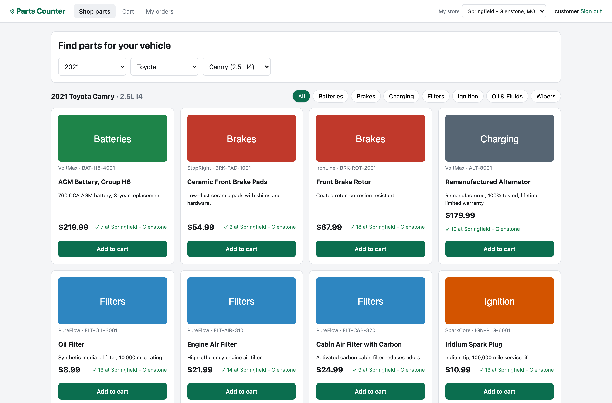

# auto-parts-digital-commerce

Auto parts commerce for both channels: **retail (B2C)** buy-online-pick-up-in-store, and **Pro (B2B)** commercial
accounts for repair shops and mechanics, with contract and tier pricing, charge-to-account on Net 30 terms, PO numbers and
delivery to the shop. Find parts by **year / make / model**, see stock at your store, and check out through a **saga** that
reserves stock, then authorizes the card or places a credit hold, and compensates on failure.
Java 21 / Spring Boot microservices for **GKE**, on **Spanner**, **Memorystore (Valkey)**, **Pub/Sub** and **GCS**,
fronted by **Apigee**, secured with **OAuth2/OIDC** and an **Istio** zero-trust mesh, provisioned with **Terraform**
and deployed with **Helm**.

> Independent portfolio project. Brands, SKUs and stores are fictional.



## Architecture

```
Browser / mobile / partners
   │  Apigee (API key, spike arrest, per-app quota, CORS)            deploy/apigee
   ▼
gateway  (Spring Cloud Gateway: JWT, per-user rate limit in Valkey, circuit breaker on catalog, no internal routes)
   │
   ├── catalog-service ── Spanner (vehicles ⟂ fitments interleaved, parts) · Valkey cache-aside · GCS images
   ├── inventory-service ─ Spanner (stores ⟂ stock interleaved, reservations) · consumes order events
   ├── checkout-service ── cart in Valkey · SAGA orchestrator · outbox → Pub/Sub · CQRS read model in Valkey
   │        │ Resilience4j: Retry(CircuitBreaker(Bulkhead(call))) per dependency, token relay
   │        ├──► catalog (prices)   ├──► inventory (reserve / release)   └──► payment-service (authorize)
   ├── payment-service ── mock processor, idempotent by order ID, admin fault injection
   └── account-service ── Pro accounts: Spanner (accounts ⟂ members, contract prices interleaved; credit holds)
            contract price > tier discount > list · credit holds in read-write transactions · owner/buyer roles

Pub/Sub topic order-events (ordering key = order ID, DLQ)
   ├── inventory.order-events   → commit stock on OrderConfirmed, release on OrderFailed   (choreography)
   ├── checkout.order-history   → order-history projection, per user and per Pro account  (CQRS)
   └── account.order-events     → capture credit hold on OrderConfirmed, release on OrderFailed
```

## How the job description maps to the code

| Requirement | Where |
|---|---|
| Microservices, EDA, **orchestration and choreography** | `CheckoutSaga` orchestrates reserve → pay → confirm; inventory reacts to events on its own (`InventoryEvents`) |
| **Saga** with compensation | Payment failure → `RELEASE_STOCK`; if that fails too, a `ReservationReleaseRequested` event; inventory also expires orphaned holds |
| **CQRS** | Writes in Spanner (`OrderStore`); order history read model in Valkey built from events (`Messaging.project`) |
| **Transactional outbox**, idempotency | Order change + event in one Spanner transaction; `Idempotency-Key` on checkout; reservations and payments idempotent by order ID |
| **Resilience4j**: circuit breaker, bulkhead, retry, rate limit | `Downstream` + `application.yml` (retry only transient failures, with jitter); gateway token-bucket rate limiter |
| **Spanner** | Interleaved tables, covering index (`STORING`), UUID keys (no hotspots), read-write transactions to prevent overselling, stale reads for availability |
| **Memorystore (Valkey)** | Cart, catalog cache-aside with TTL (degrades gracefully), CQRS read model, gateway rate limiting |
| **GCS** | Product images (`CatalogSeeder`), public bucket with versioning in Terraform |
| **Apigee** | `deploy/apigee`: VerifyAPIKey, SpikeArrest, Quota per app, CORS, internal paths blocked |
| **OAuth2/OIDC, zero trust** | Every service validates the JWT (`SecurityConfig`); roles customer / associate / admin; Istio STRICT mTLS + AuthorizationPolicies by service identity (`deploy/istio`) |
| **GKE, Helm, Terraform, CI/CD** | `deploy/helm` (one chart, values per service, Workload Identity, probes, HPA, PDB, zone spreading); `deploy/terraform`; `.github/workflows/ci.yml` |
| **Observability** | OpenTelemetry traces and metrics → Grafana (Tempo/Prometheus); Resilience4j state on `/actuator` and the Ops page; SLO thresholds in `loadtest/` |
| **JVM / Kubernetes troubleshooting** | Container JVM flags, always-on JFR, GC logs; a JVM lab (leak, CPU hot spot, lock contention) and runbook in [docs/jvm-diagnostics.md](docs/jvm-diagnostics.md) |

## Run it locally

Requires Docker (about 6 GB of RAM for the stack).

```bash
./scripts/init-env.sh                 # random demo passwords into .env
docker compose up -d --build          # emulators, Valkey, Keycloak, Grafana, 6 services, storefront
python3 scripts/e2e.py                # 31 end-to-end checks (retail + Pro)
```

| URL | |
|---|---|
| http://localhost:5173 | Storefront. Retail: `customer`. Pro: `rick`, `jordan`, `mike`. Staff: `associate`, `admin` (passwords in `.env`) |
| http://localhost:5173/#/ops | (admin) live circuit breakers + payment fault injection |
| http://localhost:3000 | Grafana: traces across gateway → checkout → inventory / payment |

## Demo script (5 minutes)

1. **Shop:** 2021 → Toyota → Camry. Only parts that fit, with stock at the Springfield store.
2. **Checkout:** order confirms; open it to see the saga steps; inventory drops after `OrderConfirmed`.
3. **Out of stock:** switch to the Dallas store and order the alternator → `REJECTED`, nothing charged.
4. **Failure + compensation:** Ops page → payment failure rate 1.0 → order → `PAYMENT_FAILED` with `RELEASE_STOCK: OK`.
5. **Circuit breaker:** a few more orders → payment circuit **OPEN**, calls fail fast; reset → half-open → closed.
6. **JVM:** `docs/jvm-diagnostics.md` lab: heap dump of a leak, flame graph of a hot loop, thread dump of contention.

## Pro (B2B) accounts

Commercial customers are most of the business, so they get their own pricing, credit and ordering rules rather than a
coupon on the retail flow. Demo accounts (seeded by `commerce-common/.../seed/DemoAccounts.java`):

| User | Account | Role | What it shows |
|---|---|---|---|
| `rick` | Rick's Automotive (repair shop, GOLD, Net 30, $5,000 limit) | Owner | Contract prices, charge to account with PO, delivery to the shop, whole-account order history |
| `jordan` | Rick's Automotive | Buyer, $750 per-order limit | Orders over the limit are declined: "ask the account owner" |
| `mike` | Mike's Mobile Mechanic (independent, SILVER) | Owner | Only $150 of credit left: a larger order on account is declined and its stock released |

**How it works**

- **Pricing** (`POST /api/accounts/me/quote`): contract price for the account, else the tier discount for the part's
  category, else list. Checkout re-prices on the server, so the browser never sets a price.
- **Credit is a saga step.** For `paymentMethod: ACCOUNT`, `HOLD_CREDIT` replaces `AUTHORIZE_PAYMENT`. The hold is a Spanner
  read-write transaction that checks account status, the buyer's per-order limit and available credit
  (limit − open balance − holds), then reserves the amount. It is idempotent by order ID, so a retried call never holds twice.
- **Settlement by event.** `OrderConfirmed` turns the hold into open balance (the Net 30 receivable); `OrderFailed` releases it.
  A sweeper releases holds left by orders that never finished.
- **Who sees what.** Account owners see every order placed on the account (`GET /api/orders?scope=account`, a Valkey
  projection keyed by account); buyers see only their own. Retail customers cannot charge to account or request delivery (403).
  Store staff see all Pro accounts and their credit position on the Ops page.
- **Internal by default.** Credit-hold endpoints have no gateway route, and the Istio policy allows only checkout-service to call them.

**Pro demo:** sign in as `rick` → the shop shows net prices with list struck through → add brake pads → Cart: deliver to the
shop, charge to account, PO `RA-4471` → the order shows `HOLD_CREDIT: OK` → Account page: balance up, hold back to zero.
Then sign in as `jordan` and order more than $750 on account (declined), and as `mike` order more than $150 (declined, stock released).

## Deploy to GCP

`deploy/terraform` (GKE Autopilot, Spanner, Memorystore for Valkey via PSC, GCS, Pub/Sub with DLQ, Artifact Registry,
per-service Google service accounts with Workload Identity, keyless GitHub OIDC), then `helm upgrade --install` each
service with `deploy/helm/values/<service>.yaml`, apply `deploy/istio`, and import `deploy/apigee` into an Apigee X
org. These create billable resources; size and delete accordingly.
